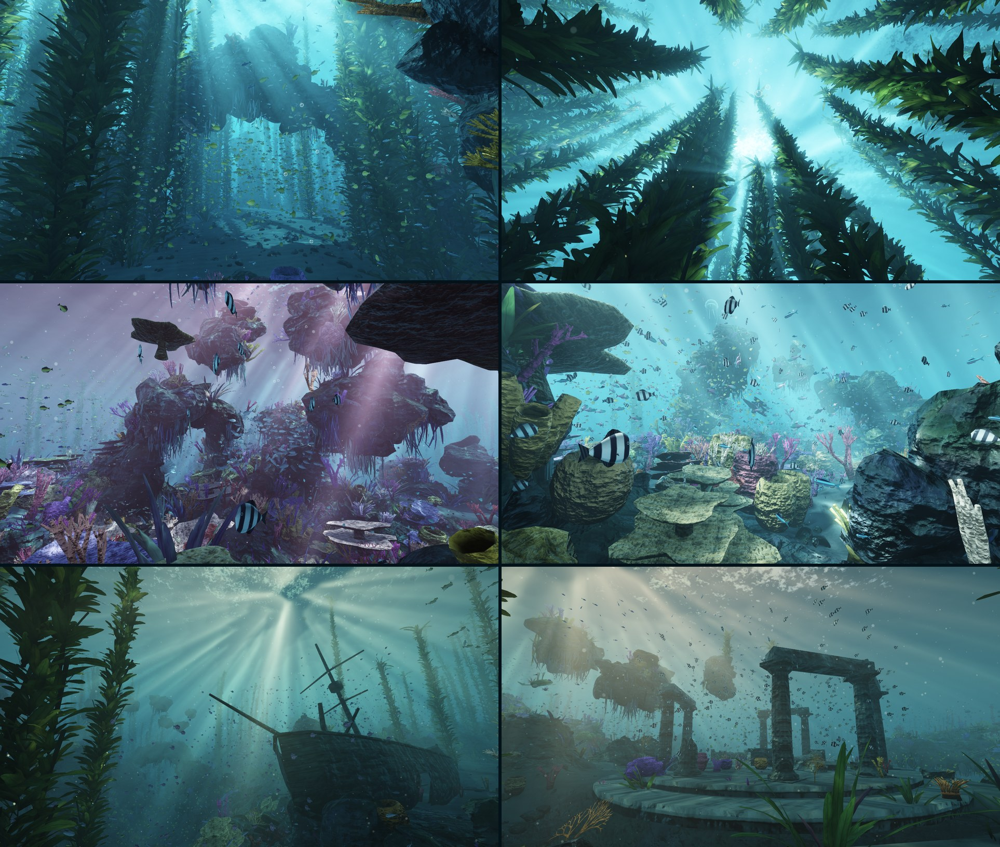
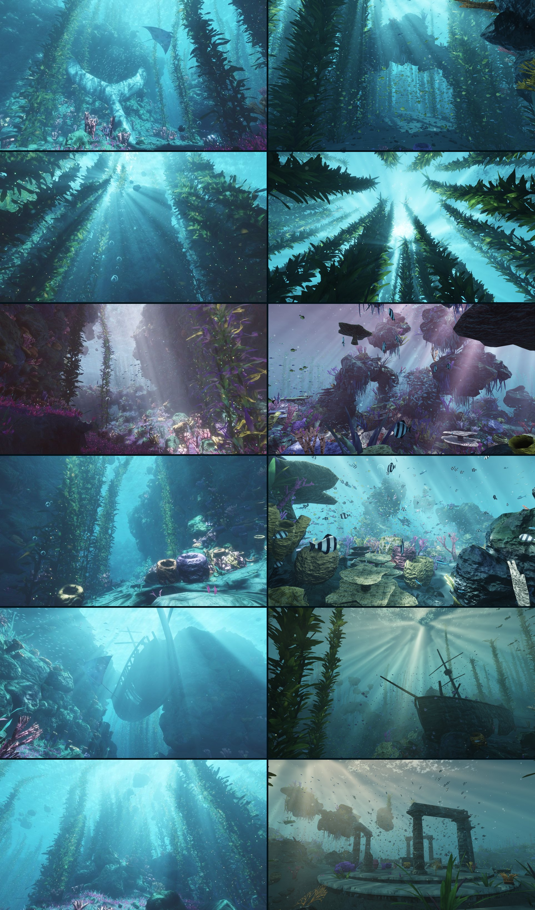

# 海底世界漫遊

單一 HTML 檔的 3D 海底世界，可在水中自由游動。優先使用 WebGPU，不支援時自動改用 WebGL2。

**線上瀏覽：https://licni.github.io/ocean/**

## 操作

| 按鍵 | 功能 |
|---|---|
| W A S D | 移動 |
| 滑鼠 | 視角（點畫面鎖定，Esc 釋放） |
| 滾輪 | 焦距 |
| Space / Q | 上浮 / 下潛 |
| Shift | 加速 |
| F | 探照燈 |
| N | 切換時間（自動／正午／黃昏／夜晚／清晨） |
| 1 – 6 | 跳到六個預設視點 |

手機可用畫面上的虛擬搖桿與按鈕。左上角「繪圖」欄顯示 WebGPU 才是完整畫面，WebGL2 為舊版後備畫面。

## 畫面



對照（左：參考作品截圖，右：本作品同主題視點）：



## 原始碼與重新建置

`src/` 是 WebGL2 引擎與共用的頁面／輸入／數學部分，`g/` 是 WebGPU 引擎（地形、模型、光影、生物、渲染迴圈）。`build.py` 把它們組合成單一 `index.html`：

```
python3 build.py
```

只需要 Python 3，不需安裝任何套件。

## 致謝

美術方向參考 [Noniv/abyssal-garden](https://github.com/Noniv/abyssal-garden)（MIT 授權）；本作品的程式為獨立重寫。
